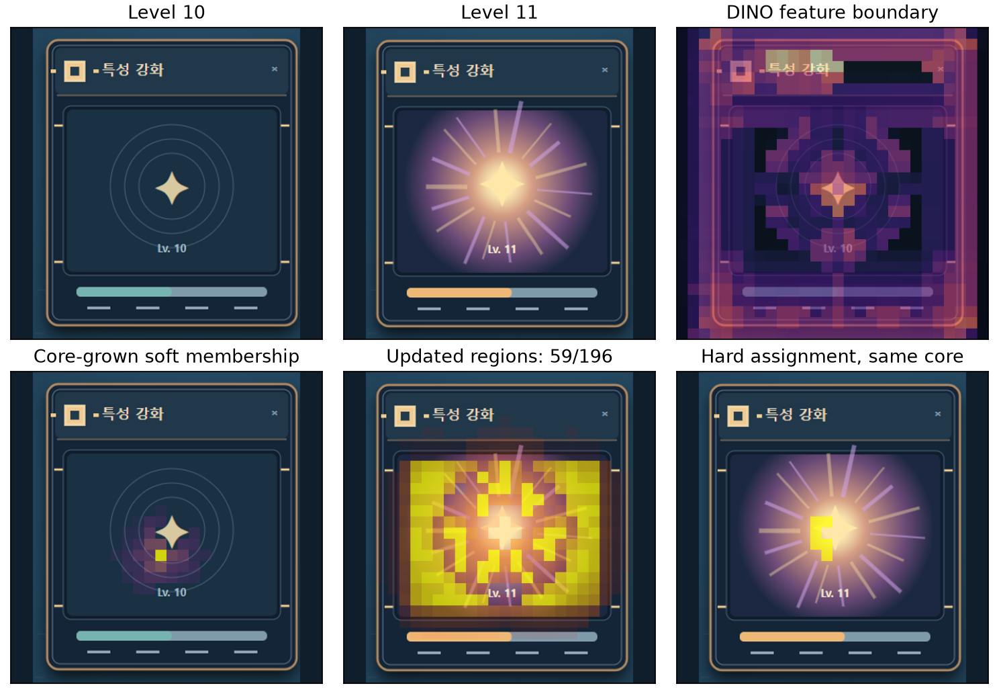

# Rune Hunt UI Learning Lab

게임을 조작하면서 **확인된 창을 기억하고, 외형이 바뀐 뒤 더 잘 다시 찾을 수 있는가**를 실험한 공개 연구 기록입니다. 브라우저 게임 두 개와 DINOv3 특징 기반 온라인 기억 갱신 실험 코드, 관측 결과를 담았습니다. 이 저장소는 완성된 범용 UI 탐지기가 아닙니다.



## 먼저 확인할 결론

레벨 10의 강화 창을 기억한 뒤, 레벨 11에서 게임 피드백으로 *같은 창임을 확인하고* DINOv3 패치 특징 기억을 한 번 갱신했습니다. 그 결과 미래 레벨 12·16·20의 **정답 후보 1위**는 규칙 격자 기준 7/48 → 15/48, 약한 경계 시작점은 7/48 → 14/48, 특징 대표점은 7/48 → 14/48이었습니다. 하지만 후보는 이미 주어진 세 위치뿐이고, 세 후보를 무작위로 고를 때 기대값이 16/48입니다. 검증 세션에서 정한 존재 판정 기준까지 통과한 **수용된 정답은 세 방식 모두 1/48**이었습니다. 즉 특징 기억 갱신의 일부 효과는 관측했지만, 안정적인 재탐지는 아직 달성하지 못했습니다.

모델 **가중치는 학습하지 않았습니다.** DINOv3 ViT-S/16의 3번째 중간층에서 448×448 입력의 28×28 패치 특징을 뽑고, 게임이 정체를 확인해 준 창의 일부 패치 **기억만** 갱신합니다. 여기의 수치는 YOLO나 개체별 Adapter를 추가 학습한 결과가 아닙니다.

## 저장소 구성

| 경로 | 내용 |
|---|---|
| `index.html` | 룬 탐험 게임 |
| `upgrade.html` | 외형이 11레벨에 바뀌는 강화 창 게임·데이터 내보내기 |
| `export_upgrade_dataset.mjs` | 브라우저 화면을 캡처해 세션별 데이터 생성 |
| `experiments/dinov3_features.py` | 로컬 DINOv3 가중치 로딩과 패치 특징 추출 |
| `experiments/adaptive_soft_regions.py` | 196개 중첩 불규칙 구역, 후보 비교와 기억 갱신 |
| `experiments/compare_seed_selection.py` | 격자·약한 경계·특징 대표점 시작점 비교 |
| `experiments/measure_learning_gain.py` | 기억 고정·11레벨 1회 갱신·계속 갱신 비교 |
| `results/` | 기존 실행에서 얻은 JSON과 대표 그림 |
| `docs/RESEARCH_LOG.md` | 문제→시도→결과→남은 과제 |

## 게임 실행

`index.html`과 `upgrade.html`을 브라우저에서 엽니다. 강화 게임은 세 창 중 같은 창을 골라 1→20레벨로 진행하며, 11레벨부터 이펙트 변화·내부 재배치·유사 방해 창 조건을 선택할 수 있습니다. `upgrade.html`의 **기본 조건 데이터 다운로드** 버튼은 브라우저에서 생성한 PNG 포함 JSON을 저장합니다.

## 실험 재현

1. Python 가상환경에서 **사용 중인 CPU/CUDA에 맞는 PyTorch**를 [공식 설치 안내](https://pytorch.org/get-started/locally/)에 따라 설치하고 `pip install -r requirements.txt`를 실행합니다. 관측 결과 생성 환경은 Python 기반, PyTorch 2.13.0+cu126, Transformers 4.57.6, NumPy 2.5.2, OpenCV 5.0.0, Pillow 12.3.0, Matplotlib 3.11.2였습니다. 운영체제·드라이버에 따라 같은 버전 구성이 불가능할 수 있습니다.
2. [Meta의 DINOv3 ViT-S/16 모델 페이지](https://huggingface.co/facebook/dinov3-vits16-pretrain-lvd1689m)에서 접근 권한과 모델 라이선스를 확인한 뒤, 모델 파일을 로컬 `models/dinov3-vits16/`에 두거나 `DINOV3_MODEL_DIR` 환경변수로 위치를 지정합니다. 가중치와 원본 대용량 데이터는 이 저장소에 없습니다.
3. Node.js와 Google Chrome이 있으면 아래처럼 **브라우저 렌더링** 화면을 생성합니다. Windows에서 Chrome이 기본 경로가 아니면 `--chrome`으로 지정합니다. `--study`는 세 조건 실험을 생성합니다. 생성 데이터는 용량이 커서 Git에 포함하지 않습니다.

```powershell
node export_upgrade_dataset.mjs --study --seed-offset 610839776 --dataset data/upgrade-confirmation-dataset.json --preview data/upgrade-confirmation-preview.png
node export_upgrade_dataset.mjs --study --seed-offset 324508639 --dataset data/upgrade-replication-dataset.json --preview data/upgrade-replication-preview.png
python experiments/compare_seed_selection.py --dataset data/upgrade-confirmation-dataset.json
python experiments/compare_seed_selection.py --dataset data/upgrade-replication-dataset.json --out results/generated/seed-selection-comparison-replication
python experiments/measure_learning_gain.py
```

위 명령은 재현 경로를 제공하지만, 이 공개 패키지에서 **전체 모델 추론까지 새로 완주했다고 주장하지 않습니다.** 원래 실험의 브라우저 exporter는 현재 실행 환경에서 Chrome DevTools WebSocket 오류가 있어 재실행 검증이 제한되었습니다. 게임 화면의 수동 데이터 다운로드도 사용할 수 있지만, 두 실험용 데이터셋과 동일한 시드·세션 구성으로 비교하려면 위 exporter를 사용해야 합니다. 상세 출력은 `results/generated/`에 저장됩니다.

## 평가 경계와 데이터 누출 주의

- 세 후보 상자는 게임이 미리 제공합니다. **화면 전체에서 임의 위치를 새로 찾는 탐지 실험이 아닙니다.**
- 훈련·검증·테스트는 세션 단위로 나뉘지만 동일한 합성 게임 렌더러이고, 해당 세션들은 과거 탐색에 이미 사용되었습니다. 새 게임이나 미사용 시드에 대한 일반화 성능·유의성 주장은 불가합니다.
- 정답은 점수 계산 전에 사용하지 않습니다. 기억 갱신은 클릭/게임 피드백으로 정체를 확인한 뒤 다음 화면을 위해서만 합니다. 이 **확인 오라클**이 실제 게임에 항상 존재하는 것은 아닙니다.
- `results/`의 숫자는 위 조건의 관측값이며, 예전 대화에서 등장한 그 밖의 수치는 실험 조건이 다르거나 예시일 수 있습니다. 서로 다른 설정의 지표를 직접 비교하지 마세요.
- 대용량 화면 데이터, DINOv3 가중치, YOLO 체크포인트, 서드파티 OmniParser 파일은 공개 패키지에 포함하지 않습니다. 각 모델의 라이선스·접근 조건은 원 배포처에서 확인하세요.

현재 이 저장소에는 **라이선스 파일이 없습니다.** 공개 열람은 가능하지만 재사용 허락을 별도로 부여하지 않은 상태입니다.
