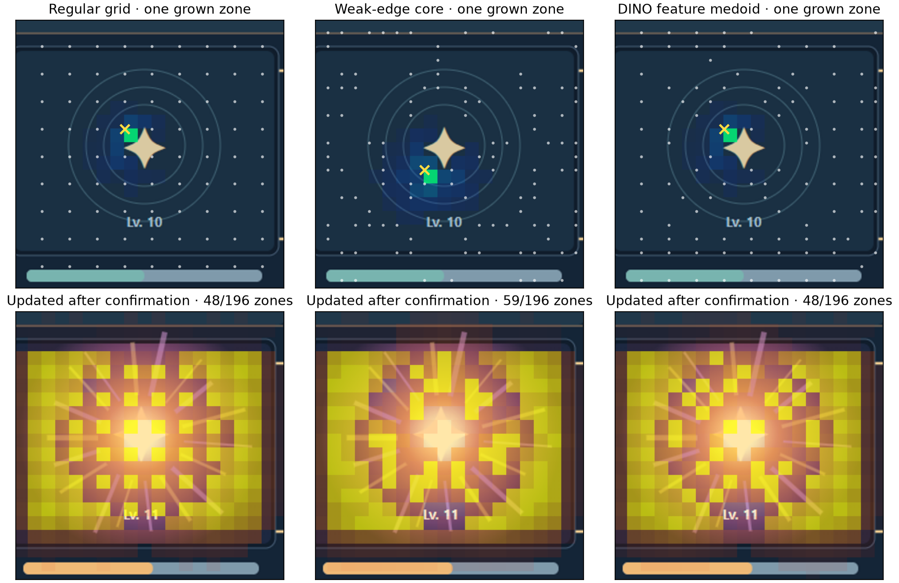

# 게임 UI 재탐지 연구 기록

## 목표와 시스템 위치

목표는 게임을 플레이하며 **정체가 확인된 개체**의 관측을 축적해, 이후 이동·레벨업·이펙트·내부 배치 변화가 있어도 같은 개체/창을 더 잘 찾는 것입니다. 필요한 파이프라인은 `초기 후보 발견 → 개체/창 구조 추정 → 동일성 비교 → 행동 피드백으로 확인 → 선택적 기억 갱신 → 다음 화면에서 재탐지`입니다. 현재 공개된 정량 실험은 이 중 **이미 주어진 세 창 후보 사이의 동일성 비교와 확인 후 기억 갱신**에 한정됩니다. 앞단의 완전 자동 후보 발견, 안전한 확인, 새 게임 일반화는 아직 비어 있습니다.

## 문제에서 실험으로

1. **초기 인식:** Exemplar Matching은 저장한 예시와 새 후보의 특징을 직접 비교합니다. 개체별 Adapter는 모델 일부를 추가 학습해 특정 개체의 표현을 바꾸려는 방향입니다. 둘 모두 이미지 특징을 쓰지만, 이 공개 실험의 최종 코드는 Adapter 가중치 훈련이 아니라 DINOv3를 고정한 메모리 갱신 방식입니다. OpenCV 경계/템플릿, DINOv2/v3 특징, YOLO 초기 창 검출도 탐색했으나 여기의 수치와 같은 조건의 공정 비교표로 합치지 않았습니다.
2. **외형 변화:** 레벨 10까지 같은 창을 기억해도 11레벨부터 내부 이펙트·배치가 달라지면 전체 창 특징이 흔들릴 수 있습니다. 바깥틀과 내부를 나눠 비교하고 변화한 부분을 덜 믿으려 했습니다.
3. **구역 분리:** OmniParser와 기하학적 사각형 재귀 분리, DINO 특징 맵, TokenCut형 비지도 객체 발견, 특징 변화량 경계를 검토했습니다. 정확한 경계를 선결조건으로 두면 경계 오차나 여러 구역에 걸친 변화에 취약하므로, 중첩되는 작은 불규칙 구역을 실험했습니다. TokenCut 논문의 목적은 일반 이미지의 비지도 객체 발견이며, 게임 UI 내부 DOM 같은 계층을 보증하지 않습니다.
4. **확인 후 학습:** 448×448 후보 창에서 DINOv3 ViT-S/16 3층의 28×28 패치 특징을 추출합니다. 14×14=196개 시작점을 두고 특징 유사도로 구역을 확장하며 소속 강도를 겹치게 둡니다. 레벨 11의 정체를 게임 피드백으로 확인했을 때, 변화한 일부 패치의 **메모리 벡터**를 갱신합니다. DINOv3·YOLO·OmniParser 가중치는 갱신하지 않습니다.
5. **시작점 비교:** 규칙 격자, 특징 차이가 약한 지점, 주변 특징의 대표점을 같은 후속 알고리즘으로 비교했습니다. 갱신 후 미래 레벨 12·16·20에서 정답 후보 1위는 개발/복제 데이터 각각 격자 7/24·6/24, 약한 경계 6/24·6/24, 대표점 7/24·5/24였습니다. 이 비교에서는 경계 기반 시작점의 우위가 나타나지 않았습니다.
6. **학습 효과 분리:** 동일한 두 데이터셋의 미래 48화면에서 `기억 고정 / 11레벨 확인 후 1회 갱신 / 이후에도 계속 갱신`을 비교했습니다.

| 시작점 | 고정 | 11레벨 1회 갱신 | 계속 갱신 |
|---|---:|---:|---:|
| 격자 | 7/48 | 15/48 | 13/48 |
| 약한 경계 | 7/48 | 14/48 | 12/48 |
| 특징 대표점 | 7/48 | 14/48 | 12/48 |

이 표는 **세 후보의 상대 순위**입니다. 세 개 중 무작위 선택의 기대치는 16/48입니다. 검증 세션에서 정한 대상 존재 점수까지 통과한 정답은 1회 갱신 시 세 방식 모두 **1/48**이었습니다. 한 번 갱신이 순위를 약간 높였어도 운용 가능한 탐지율은 아니라는 뜻입니다. 계속 갱신이 더 낮은 원인은 추가 갱신이 기억을 흐릴 가능성 등으로 추정할 수 있지만 이 데이터로 확정할 수 없습니다.

## 제한과 다음 실험

가장 큰 공백은 **초기 후보를 어떻게 얻는지**, 그리고 **모델이 처음에 틀렸을 때 오답을 학습하지 않고 어떻게 확인받는지**입니다. 다음에는 자동 후보 발견기를 동일 화면에서 비교하고, 정답 피드백이 없는 화면은 보류하는 정책을 둬야 합니다. 기존 기억과 새 기억을 분리하여 검증 후 활성화하고, 대상 부재·유사 방해 창·새 시드·새 UI 테마를 포함한 처음 보는 게임 세션을 최종 테스트로 잠가야 합니다. 상자 위치 흔들림과 내부 구조 분리 성능을 따로 평가하고, 후보 제안·동일성 순위·존재 판정·행동 성공을 혼동하지 않아야 합니다.

두 데이터셋은 동일한 합성 렌더러이며 이전 탐색에 이미 쓰였으므로 독립적 최종 검증이 아닙니다. 예전 대화의 수치 중 이 파일에 조건과 함께 제시하지 않은 값은 예시나 별도 실험 결과일 수 있습니다.
